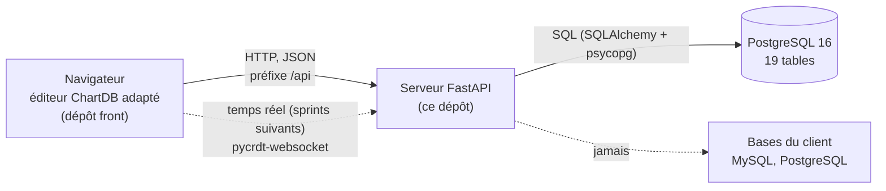
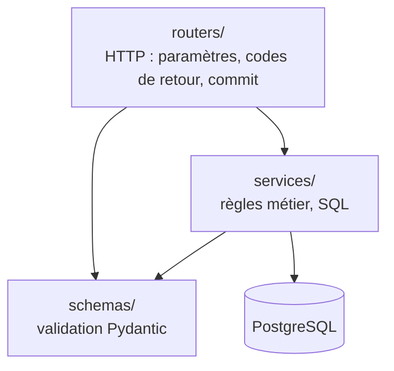
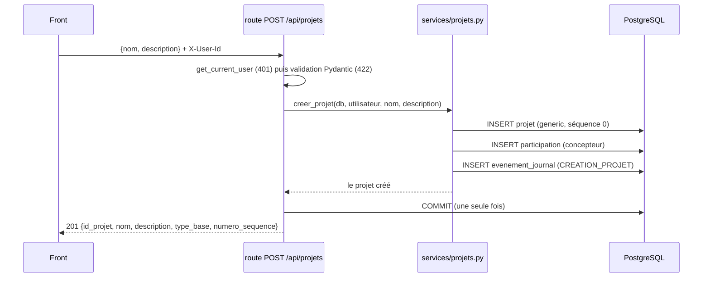
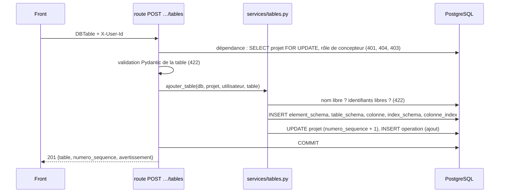
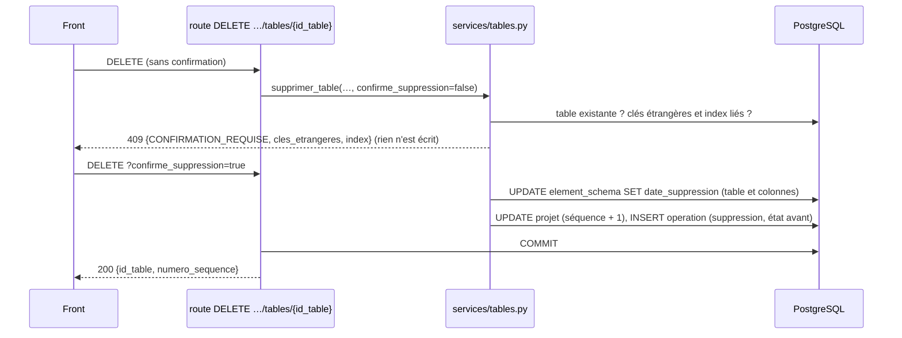

# Architecture du back-end

Ce document explique **comment le serveur est construit** : où est quoi, qui a le droit d'appeler qui, comment une
requête traverse le code, et pourquoi certains choix ont été faits. Pour le **contrat** des routes, voir
[`CONTRAT_API.md`](CONTRAT_API.md) ; pour la liste de ce qui est fait ou non, voir [`API.md`](API.md).

Le dossier de conception (chapitres 4 et 5, version 1.2) fait foi. Ce document le complète avec ce qui a été réalisé.

---

## 1. Vue d'ensemble



- Le front envoie et reçoit des objets au **format JSON de ChartDB** (principe P1).
- Le serveur **fait foi** (P2) : il vérifie les droits et les règles, et calcule lui-même les numéros de séquence.
- La base ne contient que les données de DraftDB. Le serveur **ne se connecte jamais aux bases du client** et ne
  conserve jamais le contenu d'un dump (P6).
- Le temps réel (synchronisation, présence, prise de main) et l'authentification complète arrivent aux sprints
  suivants (voir [§ 10](#10-limites-connues-et-évolutions-prévues)).

---

## 2. Organisation du code

```text
app/
  main.py                création de l'application FastAPI, toutes les routes sous /api
  config.py              Settings (pydantic-settings) : connexion base, taille max d'un import
  database.py            get_engine, get_db : une session SQLAlchemy par requête, AUCUN commit automatique
  security.py            get_current_user : identification (provisoire, en-tête X-User-Id)

  routers/               couche 1 : reçoit la requête HTTP, délègue, renvoie la réponse
    health.py            GET  /api/health
    projets.py           POST /api/projets
    ouverture.py         GET  /api/projets/{id_projet}
    imports.py           POST /api/projets/{id_projet}/import
    tables.py            POST /api/projets/{id_projet}/tables
                         DELETE /api/projets/{id_projet}/tables/{id_table}
                         + la dépendance projet_modifiable

  services/              couche 2 : logique métier et accès à la base (SQL)
    acces.py             charger_projet, exiger_participant, exiger_responsable, exiger_concepteur
    projets.py           creer_projet
    importer.py          construire_lignes, annexes_depuis, importer_diagramme
    lecture.py           reconstituer_diagramme
    tables.py            ajouter_table, supprimer_table (+ vérifications privées)

  schemas/               objets de transfert (DTO) Pydantic
    chartdb.py           objets du format ChartDB : DBTable, DBField, DBIndex, DBRelationship, Diagramme
    projets.py           ProjetOuvert, ProjetCreation, ProjetCree
    imports.py           ImportRequest, ImportResponse
    tables.py            TableAjout, TableAjoutee, TableSupprimee, Avertissement

db/
  01_schema.sql          schéma de la base : SOURCE DE VÉRITÉ (traduction du MLD du dossier)
  02_seed.sql            données de test, développement uniquement
tests/                   tests unitaires (sans base) et d'intégration (avec base)
```

Pour ajouter une fonctionnalité : créer un fichier dans `app/routers/` (avec le service correspondant dans
`app/services/` et ses DTO dans `app/schemas/`), puis l'inclure dans `app/main.py`.

---

## 3. Les couches et leurs règles



| Couche | Elle fait | Elle ne fait **pas** |
|---|---|---|
| **Route** (`routers/`) | Déclare l'URL, les paramètres et les codes de retour (Swagger), injecte les dépendances (session, utilisateur), appelle **un** service, appelle `db.commit()` une fois si elle écrit | Pas de SQL, pas de règle métier |
| **Service** (`services/`) | Applique les règles du dossier, lit et écrit en SQL (`text()` avec paramètres nommés), lève `HTTPException` pour les refus | N'appelle pas `commit()` (sauf l'import, plus ancien, voir § 4), ne connaît pas l'objet requête HTTP |
| **Schéma** (`schemas/`) | Décrit et valide les objets échangés (types, tailles, règles internes d'un objet) | Aucun accès à la base |

Règles de dépendance : un service peut en appeler un autre (par exemple `tables.py` réutilise
`importer.construire_lignes` et `lecture.reconstituer_diagramme`), jamais l'inverse avec une route.

Accès à la base : **SQLAlchemy 2 + psycopg 3 en SQL direct**. Aucun modèle objet n'est défini : le schéma est celui de
`db/01_schema.sql`, l'API utilise les tables et ne les crée pas. Les valeurs sont **toujours** passées en paramètres
nommés (`:id_projet`), jamais concaténées dans la requête.

---

## 4. Transactions et concurrence

### Une transaction par requête d'écriture

`get_db` fournit une session par requête et **ne commite jamais** (`app/database.py`). Une route qui écrit regroupe
toutes ses écritures dans la même transaction et appelle `db.commit()` **une seule fois, à la fin** :

```python
projet = creer_projet(db, id_utilisateur, requete.nom, requete.description)   # 3 INSERT, pas de commit
db.commit()                                                                   # tout ou rien
return projet
```

Si une écriture échoue, ou si la route s'arrête sur une erreur, la session est fermée sans commit : **tout est annulé**
(rollback). Il n'existe donc pas de projet à moitié créé ni de table à moitié ajoutée.

Une valeur que PostgreSQL refuse (par exemple un caractère NUL dans un texte) est interceptée (`DataError`), la
transaction est annulée explicitement, et la réponse est un **422**, jamais un 500.

> **Exception historique :** `importer_diagramme` (`services/importer.py`) appelle `db.commit()` lui-même. Les autres
> services laissent la route le faire.

### Verrou du projet et numéro de séquence (RG-16)

Chaque modification du schéma est une **opération** numérotée par projet. Pour que deux requêtes simultanées ne
reçoivent jamais le même numéro :

1. `charger_projet(db, id_projet, verrouiller=True)` fait `SELECT … FOR UPDATE` sur la ligne du projet ;
2. le service calcule `numero_sequence = projet["numero_sequence"] + 1` ;
3. il écrit ce numéro **à la fois** dans `operation` et dans `projet.numero_sequence`.

La base ajoute une garantie : `UNIQUE (id_projet, numero_sequence)` sur `operation`. Le verrou dure jusqu'à la fin de
la transaction. Vérifié avec 40 ajouts simultanés sur le même projet : 40 numéros distincts, de 1 à 40, sans trou.

---

## 5. Identification et droits

### Identification provisoire

`get_current_user` (`app/security.py`) lit l'en-tête **`X-User-Id`** (un UUID d'utilisateur existant) et répond **401** si
l'en-tête est absent, n'est pas un UUID, ou ne correspond à aucun utilisateur. Cela **ne protège rien** : n'importe qui
peut écrire n'importe quel UUID. C'est volontaire au sprint 1.

Quand le login existera (CU 0.1 à 0.3), **seul le corps de `get_current_user` changera** : les routes qui en dépendent
n'auront pas à être modifiées.

### Contrôles de droits (`services/acces.py`)

| Fonction | Refuse (403) quand… | Utilisée par |
|---|---|---|
| `charger_projet` | (404 si le projet n'existe pas) | toutes les routes sur un projet |
| `exiger_participant` | l'utilisateur ne participe pas au projet (le responsable est toujours accepté) | ouverture, import |
| `exiger_responsable` | l'utilisateur n'est pas le responsable du projet | import |
| `exiger_concepteur` | l'utilisateur n'a pas le rôle de concepteur (`participation.est_concepteur`) | ajout et suppression de table |

Le responsable n'est concepteur que s'il a ce rôle : il le reçoit à la création du projet (CU 1.1) et pourra l'ajuster.

### Ordre des contrôles

Pour chaque route, le dossier impose un ordre : **401, puis 403, puis 404 / 422 / 409**. Une personne sans droit ne
doit pas apprendre si sa requête était valide ou si une table existe.

FastAPI valide normalement le corps **avant** d'exécuter le code de la route, ce qui donnerait un 422 avant un 403.
Pour respecter l'ordre, les routes `tables` utilisent une **dépendance** (`projet_modifiable`, dans
`routers/tables.py`) qui charge le projet, le verrouille et exige le rôle de concepteur : les dépendances s'exécutent
**avant** que les erreurs de validation du corps soient levées.

```text
401  get_current_user          (dépendance)
404  charger_projet            (dépendance projet_modifiable)
403  exiger_concepteur         (dépendance projet_modifiable)
422  validation du corps       (Pydantic, après les dépendances)
422  règles lues en base       (service : nom libre RG-10, identifiants libres P3)
```

---

## 6. Base de données

`db/01_schema.sql` est la **source de vérité** : 19 tables en 5 domaines, traduction du MLD du dossier (§ 3.2).

| Domaine | Tables |
|---|---|
| Comptes, projets et journal | `utilisateur`, `session`, `projet`, `participation`, `evenement_journal` |
| Structure du schéma | `element_schema`, `table_schema`, `colonne`, `index_schema`, `colonne_index`, `relation` |
| Historique, versions, approbation | `operation`, `version`, `decision` |
| Livraison et reprise de l'existant | `script_sql`, `import_dump` |
| Collaboration en séance | `discussion`, `message`, `prise_de_main` |

### Conventions

- **Identifiants ChartDB** (tables, colonnes, index, relations) : `VARCHAR(25)`, fournis par le navigateur et
  **jamais régénérés** (P3). Un identifiant déjà utilisé est refusé (422), y compris celui d'un élément supprimé.
- **Autres identifiants** : UUID générés par la base (`gen_random_uuid()`). Dates : `TIMESTAMPTZ`.
- **Suppression logique** (P4) : seule `element_schema` (donc tables et colonnes) porte `date_suppression`. Un index ou
  une relation disparaît du schéma courant avec sa table ou sa colonne. Aucune clé étrangère n'est en
  `ON DELETE CASCADE`, sauf `colonne_index`.
- **Spécialisation** : `table_schema` et `colonne` ont pour clé primaire l'identifiant de `element_schema`.
- **JSONB** pour ce qui garde le format ChartDB (`projet.annexes`, `version.instantane`) ou qui est un contexte
  (`operation.donnees_avant` et `donnees_apres`, `evenement_journal.details`, `import_dump.rapport`).

### Règles portées par la base

`UNIQUE` sur `utilisateur.login` (RG-01), `CHECK` rôle d'un participant (RG-06), type de base (RG-11), clé primaire non
nullable et rang ≥ 1 (RG-12), cardinalités (RG-13), un rang par colonne d'index (RG-14), numéro de séquence unique par
projet (RG-16), règles des versions et décisions (RG-17 à RG-20), index partiel « une seule prise de main en cours »
(RG-28). Les autres règles (RG-10, RG-13 sur la cible, P3…) sont contrôlées par l'API.

### Correspondance ChartDB ↔ tables

| Objet ChartDB | Où il est stocké |
|---|---|
| `DBTable` (`id`, `name`, `schema`, `x`, `y`, `width`, `color`, `comments`, `isView`) | `element_schema` + `table_schema` |
| `DBField` (`id`, `name`, `type.id`, `characterMaximumLength`, `precision`, `scale`, `nullable`, `unique`, `primaryKey`, `increment`, `default`, `collation`, `comments`) | `element_schema` + `colonne` (le rang est la position dans `fields`, à partir de 1) |
| `DBIndex` (`id`, `name`, `unique`, `type`, `isPrimaryKey`, `fieldIds`) | `index_schema` + `colonne_index` (le rang est la position dans `fieldIds`) |
| `DBRelationship` | `relation` (les tables source et cible se déduisent des colonnes) |
| zones, notes, types personnalisés, dépendances | `projet.annexes` (JSONB, format ChartDB) |
| nom du diagramme | `projet.nom` ; `databaseType` ↔ `projet.type_base` |

---

## 7. Le format ChartDB

Les objets échangés sont décrits par des DTO Pydantic dans `schemas/chartdb.py`, avec les noms (en camelCase) du JSON
de ChartDB, via des alias (`primary_key` ↔ `primaryKey`). Les champs inconnus sont **conservés** (`extra="allow"`) :
le serveur renvoie ce qu'il a reçu, sans rien perdre.

Les validations se font avant toute écriture. Pour un diagramme complet (import) : au moins une table, identifiants
uniques, nom de table libre (RG-10), clé primaire non nullable (RG-12), relations entre deux colonnes distinctes et
présentes (RG-13), index sur des colonnes de leur table sans doublon (RG-14). Pour une seule table (ajout), la
sous-classe `TableAjout` applique les règles internes à la table (`schemas/tables.py`).

Les tailles viennent du dictionnaire de données : nom ≤ 63 caractères, identifiant ≤ 25, type ≤ 30, etc. (liste
complète dans [`CONTRAT_API.md`](CONTRAT_API.md#2-objets-échangés-format-chartdb)).

**RG-10 et schéma SQL :** deux tables d'un même projet ne portent pas le même nom **au sein d'un même schéma SQL**
(`schema` absent et vide sont équivalents). Deux tables de même nom dans des schémas différents sont acceptées.

---

## 8. Flux détaillés

### Créer un projet (CU 1.1)



### Ajouter une table (CU 2.1)



Aucun événement n'est écrit dans le journal d'activité pour un ajout : l'opération (`operation`) suffit.

### Supprimer une table en deux appels (CU 2.3)



Le premier appel n'écrit rien et prévient le concepteur de ce que la suppression touche. La confirmation est exigée à
chaque suppression, même sans lien (diagramme du dossier, fig. 34). L'**état avant** de la table, au format ChartDB,
est conservé dans `operation.donnees_avant` : il permet de la restituer dans l'historique.

### Importer un dump (CU 1.5)

Le dump est analysé **dans le navigateur** par le module d'import SQL de ChartDB. Le serveur ne reçoit **jamais** le
fichier : il reçoit le diagramme obtenu, les caractéristiques du fichier (nom, dialecte, taille) et le rapport des
instructions non reprises (ligne, type, raison, **jamais** le texte, RG-24). Dans une seule transaction, il supprime
logiquement l'ancien schéma si le remplacement est confirmé, enregistre le nouveau, fixe le dialecte du projet,
écrit l'opération `import`, la trace `import_dump` et un événement `IMPORT`. **L'import ne crée pas de version** : le
responsable en crée une nommée ensuite (CU 3.1).

### Ouvrir un projet (CU 1.6)

Lecture seule, sans verrou. `reconstituer_diagramme` recompose le diagramme ChartDB à partir de l'état courant :
tables et colonnes dans l'ordre du rang, index, relations dont les deux tables sont visibles, annexes. Les éléments
supprimés logiquement ne sont pas renvoyés.

---

## 9. Gestion des erreurs

Corps d'erreur : `{"detail": …}`.

| Cas | Code | `detail` |
|---|---|---|
| Non identifié | 401 | texte |
| Pas de droit | 403 | texte |
| Projet ou table introuvable | 404 | texte |
| Confirmation requise (import, suppression) | 409 | objet `{"code": "CONFIRMATION_REQUISE", …}` ; rien n'est modifié |
| Fichier trop volumineux (import) | 413 | texte |
| Validation du corps (Pydantic) | 422 | **liste** `[{type, loc, msg, input}]` |
| Règle métier (nom pris, identifiant déjà utilisé, valeur refusée par la base) | 422 | texte |
| Erreur technique en base | 500 | transaction annulée |
| Base injoignable | 503 | uniquement sur `/api/health` ; les autres routes répondent 500 |

---

## 10. Limites connues et évolutions prévues

| Sujet | État |
|---|---|
| Authentification | Provisoire (`X-User-Id`). Argon2, sessions et login : CU 0.1 à 0.3. |
| Temps réel | Non réalisé. `pycrdt-websocket` pour la synchronisation, la présence et la prise de main. |
| Prise de main (RG-29) | Non contrôlée : l'ajout et la suppression de table ne vérifient pas qu'un autre concepteur détient la main (CU 2.6). |
| Contrôles de cohérence complets | Non réalisés (CU 2.4 et 2.5). Seul l'avertissement « table sans clé primaire » existe (EX-05). |
| Relations et index à la suppression d'une table | Non traités : ils disparaissent du schéma avec leur table (à confirmer avec CU 2.4 et 2.5). |
| Versions, approbation, scripts de migration, export | Non réalisés (CU 3.x). |
| Doublon de SQL | Les `INSERT` de `services/tables.py` sont recopiés de `importer.py` : à factoriser dans un commit `[REFACTOR]`. |
| Coût de l'état avant | `supprimer_table` relit tout le diagramme du projet pour en extraire une table : simple, mais à optimiser si les schémas grossissent. |
| Dépendances | `pydantic` et `pytest` ne sont pas épinglés dans `requirements.txt` (et `pytest` y figure alors qu'il est dans `requirements-dev.txt`). |
| Intégration continue | Absente : les tests se lancent à la main avant chaque PR. |

---

## Tests

139 tests (au 22/11/2026), en deux familles :

- **Sans base** : validation des objets ChartDB (`tests/test_import_diagramme.py`, `tests/test_table_ajout.py`),
  traduction en lignes de tables, route de santé avec une session factice.
- **D'intégration** (marqueur `integration`) : contre la vraie base PostgreSQL du `docker-compose` (`test_import.py`,
  `test_ouverture.py`, `test_creation_projet.py`, `test_ajout_table.py`, `test_suppression_table.py`). Ils sont **sautés**
  si la base n'est pas joignable.

### Isolation

La fixture `db_session` ouvre une connexion, démarre une transaction, donne une session qui s'y rattache (`savepoint`) et
**annule tout à la fin** : aucun test ne laisse de donnée. Les identifiants ChartDB étant des clés primaires globales,
`i("nom")` les suffixe d'un code aléatoire propre à chaque exécution pour éviter toute collision avec des données déjà
présentes.

### Fixtures (`tests/conftest.py`)

`client` (session factice, sans base), `client_db` (vraie session), `db_session`, `monde` (trois utilisateurs : responsable
et concepteur, relecteur, étranger ; plus un projet), `en_tete(id)` (en-tête `X-User-Id`).

### Pièges connus

- La route et la fixture **partagent la même session** : un `rollback()` provoqué par la route annule aussi les données
  de préparation. Pour vérifier qu'un échec n'a rien écrit, **filtrer sur les identifiants du test** plutôt que comparer
  des totaux avant et après.
- Les tests ne doivent pas dépendre du contenu de la base (seed, essais manuels) : tout filtre porte sur le projet ou
  les identifiants du test.
- Chaque test d'une règle « rien n'est écrit en cas d'erreur » doit pouvoir **échouer** : vérifier en cassant volontairement
  le code (par exemple un `commit()` en trop au milieu des écritures).

---

## Conventions de code

- Trois niveaux (route, service, schéma). Pas de SQL dans une route.
- Domaine et commentaires **en français** (`projet`, `table`, `colonne`, `participation`), avec la référence de la règle
  appliquée : `RG-10`, `P3`, `EX-05`…
- Valeurs SQL toujours en **paramètres nommés**.
- Une écriture = une transaction, un seul `commit()` dans la route.
- Une route documente ses codes de retour (`responses={…}`) pour que Swagger soit complet.
- Pas de refactor hors ticket ; un refactor important se fait dans un commit à part, préfixé `[REFACTOR]`.
- Toute nouvelle route met à jour [`CONTRAT_API.md`](CONTRAT_API.md) et [`API.md`](API.md).

### Principes de conception (dossier, § 1.6) et où ils sont appliqués

| Principe | Application dans le code |
|---|---|
| **P1** Brancher plutôt que réécrire : format JSON de ChartDB | `schemas/chartdb.py`, `lecture.reconstituer_diagramme` |
| **P2** Le serveur fait foi | `acces.py`, validations avant écriture, numéros de séquence calculés sous verrou |
| **P3** Identifiants stables | Identifiant refusé s'il est déjà utilisé (`tables._verifier_identifiants_libres`) |
| **P4** Rien ne s'efface | `date_suppression`, `operation` avec l'état avant et après |
| **P5** Un schéma neutre | `projet.type_base = 'generic'` tant qu'aucun dump n'a été importé |
| **P6** Aucune donnée chez un tiers | Le dump n'est jamais reçu ni conservé ; le rapport ne contient pas le texte des instructions |
